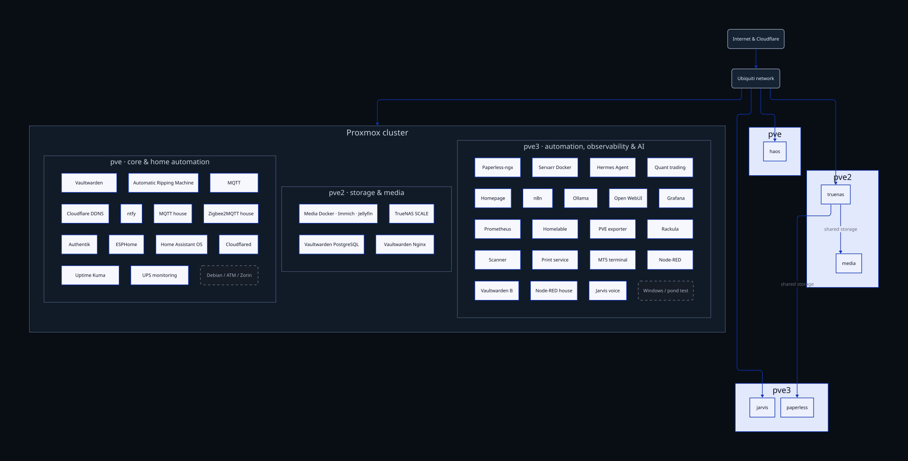

# My homelab

[](https://faerbertorben.github.io/homelab/)
[](https://www.proxmox.com/)
[](docs/reference/design-principles.md)

A documented, privacy-conscious homelab built around a three-node Proxmox cluster. It runs the services my household actually uses: smart-home control, media, documents, passwords, identity, monitoring, automations, and local AI.

> **Public-safe by design.** This repository deliberately excludes credentials, private addresses, ports, firewall rules, personal data, and production configuration.

## At a glance

| Layer | What runs here |
|---|---|
| Cluster | Three Proxmox nodes split between core/home automation, storage/media, and automation/AI |
| Storage | TrueNAS SCALE for shared storage where workloads need it |
| Smart home | Home Assistant, Node-RED, MQTT, Zigbee2MQTT, ESPHome, and Jarvis voice |
| Media & documents | Immich, Jellyfin, Servarr, Paperless-ngx, and archival tools |
| Access | Vaultwarden HA, Authentik, Cloudflare, ntfy |
| Observability | Uptime Kuma, Prometheus, Grafana, Homepage |

## Documentation

The full site is built with Material for MkDocs and published through GitHub Pages.

- [Architecture overview](docs/architecture/overview.md)
- [Topology diagrams](docs/architecture/diagrams.md)
- [Platform](docs/platform/cluster.md)
- [Service catalog](docs/services/index.md)
- [Operations](docs/operations/maintenance.md)

## Architecture maps

[](docs/architecture/diagrams.md)

The repository contains two D2 maps: an overview grouped by physical host and a network/service-flow map. The sources and rendered SVGs live together under `docs/assets/diagrams/`.

## Local preview

```bash
python -m venv .venv
. .venv/bin/activate
pip install -r requirements.txt
mkdocs serve
```

## Repository boundaries

This is documentation, not a backup, a secrets store, or a full configuration export. The goal is a useful, reviewable explanation of the homelab without making the homelab easier to attack.
