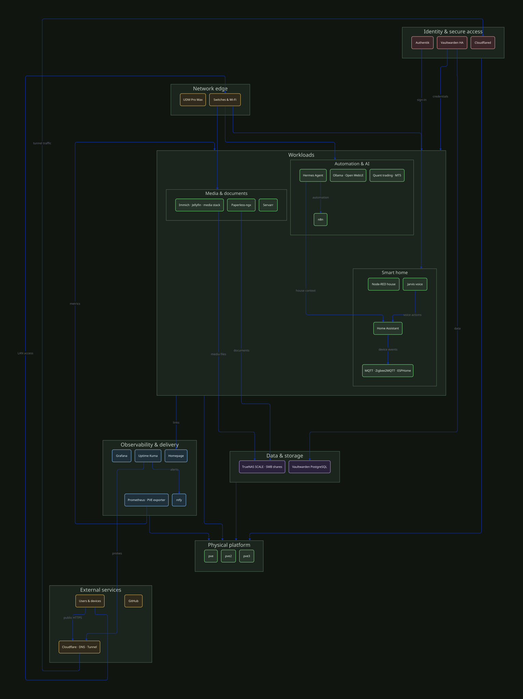

  <section class="hero-panel">
    

      
 PRIVATE INFRASTRUCTURE / DOCUMENTED

      <h1>Home infrastructure, <em>built as a system.</em></h1>
      
A three-node Proxmox cluster for the services that matter at home: automation, media, documents, identity, monitoring, and local AI.

      

        <a class="button button--primary" href="architecture/overview/">Explore the architecture <b>↗</b></a>
        <a class="button button--quiet" href="architecture/diagrams/">Open topology maps</a>
      

    

    

      
PLATFORM STATUS ●

      

        
<strong>03</strong><small>Proxmox nodes</small>

        
<strong>37</strong><small>active workloads</small>

        
<strong>24</strong><small>logical CPUs</small>

        
<strong>136 GB</strong><small>installed memory</small>

      

      
Inventory refreshed from the live cluster. Public docs intentionally omit private network details.

    

  </section>

  <section class="topology-panel">
    
01 / SYSTEM MAP

    

      <h2>Clear boundaries. Useful dependencies.</h2>
      
Services are placed by role, not by accident. The result is easier maintenance, clearer failures, and a map that stays understandable as the lab grows.

    

    

      <article>A
EDGE
<h3>Cloudflare + Ubiquiti</h3><small>Deliberate public paths and household access.</small></article>
      
<i></i>

      <article>B
COMPUTE
<h3>Three-node Proxmox cluster</h3><small>Core, storage/media, and automation/AI workloads.</small></article>
      
<i></i>

      <article>C
DATA
<h3>TrueNAS + service data</h3><small>Shared storage only where it earns its complexity.</small></article>
    

  </section>

  <section class="workload-panel">
    
02 / WHAT LIVES HERE

    

      <h2>Household-grade self-hosting.</h2>
      

        <a href="services/home-automation/"><b>01</b>Home automation<small>Home Assistant · Node-RED · MQTT · Zigbee · Jarvis</small><i>↗</i></a>
        <a href="services/media-documents/"><b>02</b>Media & documents<small>Immich · Jellyfin · Paperless · Servarr</small><i>↗</i></a>
        <a href="services/access-security/"><b>03</b>Access & security<small>Vaultwarden · Authentik · Cloudflare · ntfy</small><i>↗</i></a>
        <a href="services/automation-ai/"><b>04</b>Automation & AI<small>Hermes · n8n · Ollama · Open WebUI</small><i>↗</i></a>
      

    

  </section>

  <section class="diagram-panel">
    

03 / LIVE MAPS
<h2>Two views. One system.</h2>
The overview groups workloads by physical placement. The flow map explains the primary request, identity, storage, automation, and observability paths.
<a class="text-link" href="architecture/diagrams/">See the full diagrams →</a>

    <a class="diagram-preview" href="architecture/diagrams/" aria-label="Open homelab diagrams">OPEN FULL MAP <b>↗</b></a>
  </section>

  <section class="boundary-panel">
PUBLIC-SAFE BY DESIGN
<h2>The map is public. <em>The operating details are not.</em></h2>
Addresses, ports, credentials, firewall policy, personal data, and production configuration stay out of this repository. The architecture remains useful without becoming an attack surface.
<a class="text-link" href="reference/design-principles/">Read the design principles →</a></section>

